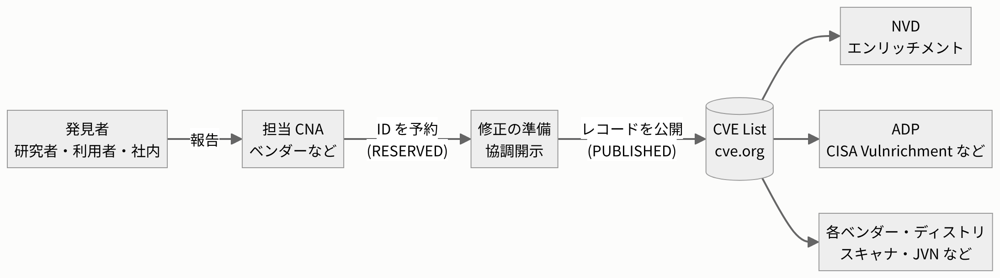
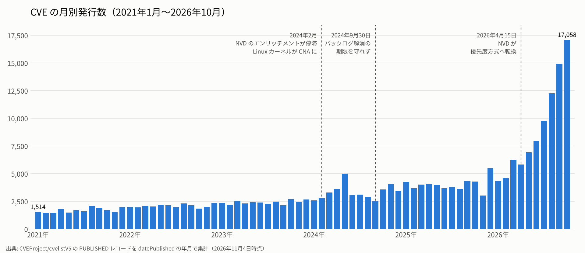

# 1. CVE における昨今の脆弱性状況の現状

> 目安時間: 15分

## この章のねらい

- CVE が「何」であり、「誰が」「どうやって」作っているのかを説明できるようになる
- ここ数年で CVE の発行数が急増していることを、実データを見て確認する
- NVD による「エンリッチメント」の役割と、それが追いつかなくなった経緯を理解する

---

## 1.1 CVE とは何か

**CVE（Common Vulnerabilities and Exposures）** は、公開された脆弱性につける**世界共通の識別子**です。

```
CVE-2021-44228
 │    │    └─ 通し番号（4桁以上。2014年以降は桁数に上限なし）
 │    └────── ID が割り当てられた年、または（割り当て前に公開されていれば）脆弱性が公開された年
 └─────────── 接頭辞
```

脆弱性情報を統一的に扱うことには大きな意味があります。ベンダーのアドバイザリ、セキュリティ製品の検知ルール、スキャナの結果、ニュース記事がそれぞれ別の呼び方をしていては、同じ脆弱性の話をしているのかすら判断できません。CVE ID は、これらをつなぐ**共通キー**として働きます。

CVE ID ひとつに対して **CVE レコード**が 1 つ作られ、主に次の情報を持っています。

| 項目 | 内容 |
|---|---|
| 説明文（description） | どの製品に、どんな問題があるか |
| 影響を受ける製品（affected） | ベンダー名、製品名、バージョン範囲 |
| 参照情報（references） | ベンダーのアドバイザリ、修正コミットなどへのリンク |
| 問題の種類（problemTypes） | CWE（弱点の種類）などの分類（任意） |
| 評価指標（metrics） | CVSS などの深刻度（任意） |

> **補足**：CVE は本来「識別子の辞書」です。深刻度の評価や影響範囲の機械可読な記述は**必須ではなく**、レコードによって記載の粒度がまちまちです。この「足りない部分を誰が補うのか」が、後半のエンリッチメントの話につながります。

## 1.2 CVE の成り立ち — 誰がどうやって作っているのか

### 歴史

- **1999年**：米国の非営利団体 **MITRE** が CVE を公開。当時はベンダーごとに脆弱性の呼び方がばらばらだったことが出発点でした。
- 現在は **CVE Program** として運営され、米国の CISA（サイバーセキュリティ・インフラストラクチャ安全保障庁）がスポンサーとして資金を出し、MITRE が事務局を務めています。方針は業界・学術・政府の有識者で構成される **CVE Board** が決めます。

### CNA — CVE ID を採番する組織

CVE ID を割り当ててレコードを公開できるのは、**CNA（CVE Numbering Authority）** として認定された組織です。CNA は MITRE だけではなく、多様な組織が担っています。

| CNA の種類 | 例 |
|---|---|
| 自社製品を担当するベンダー | Microsoft、Apple、Google、Oracle、Red Hat など |
| オープンソースプロジェクト | Linux カーネル、curl、Python など |
| 脆弱性を集約・仲介する組織 | GitHub、VulDB、VulnCheck、Wordfence、Patchstack など |
| 国・地域の CERT | JPCERT/CC など |

CNA は階層構造になっており、上位の **Root**（MITRE、CISA、JPCERT/CC など）が配下の CNA を取りまとめます。どの CNA の担当範囲にも入らない脆弱性は、最後の受け皿である **CNA of Last Resort（MITRE など）** が採番します。

### CVE が公開されるまでの流れ



1. 脆弱性の発見者が、その製品を担当する CNA に報告する
2. CNA が CVE ID を**予約**する（この時点では中身は非公開）
3. 多くのケースでは修正版の準備が整ったタイミングで、CNA が CVE レコードを **CVE List** に公開する
4. 公開されたレコードを、NVD やさまざまな事業者が取り込んで活用する

> **ポイント**：CVE レコードの内容（影響を受けるバージョンなど）を書くのは**各 CNA**です。CNA ごとに書き方の丁寧さが異なるため、同じ CVE レコードでも「影響判定にそのまま使えるか」は CNA 次第です。

## 1.3 CVE 発行数の推移 — 昨今の急増

下図は、CVE List（[CVEProject/cvelistV5](https://github.com/CVEProject/cvelistV5)）に公開されているレコードを、公開日の年月ごとに数えたものです。



| 年 | 発行数 | 前年比 | その年に CVE を公開した CNA の数 |
|---|---:|---:|---:|
| 2021 | 20,177 | — | 161 |
| 2022 | 24,999 | +24% | 201 |
| 2023 | 28,847 | +15% | 256 |
| 2024 | 39,924 | +38% | 305 |
| 2025 | 48,150 | +21% | 363 |
| 2026（1〜10月） | **89,857** | — | 399 |

- 2021年1月は月 1,514 件だったものが、2026年10月には月 **17,058 件**と約 **11 倍**になっています。
- 2026年は 10 か月の時点で、2025年の 1 年分の **約 1.9 倍** に達しています。

### 何が増加を引き起こしているのか

**(1) CNA の増加と「大量に採番する CNA」の登場（2024年〜）**

CNA の数は 5 年で 2 倍以上に増えました。特に影響が大きいのは次の 2 つです。

- **Linux カーネルの CNA 化（2024年2月）**：カーネルの修正のうち、脆弱性の可能性があるものに広く CVE を割り当てる方針をとったため、2024年だけで 4,000 件以上を採番しました。
- **WordPress プラグインなどを扱う CNA**：Patchstack、Wordfence などが、プラグインの脆弱性を大量に採番しています。

各年で採番数の多い CNA の上位 5 組織は次のとおりです（CVE List から集計）。

| 順位 | 2021 | 2023 | 2025 | 2026（1〜10月） |
|---|---|---|---|---|
| 1 | MITRE (6,473) | MITRE (6,237) | Patchstack (7,006) | GitHub (12,443) |
| 2 | GitHub (1,065) | Patchstack (2,146) | VulDB (5,901) | VulnCheck (9,277) |
| 3 | Microsoft (871) | VulDB (1,931) | Linux (5,674) | Linux (8,201) |
| 4 | WPScan (747) | GitHub (1,771) | MITRE (5,201) | VulDB (6,109) |
| 5 | IBM (605) | Microsoft (994) | Wordfence (3,450) | Patchstack (5,143) |

**(2) AI による脆弱性発見の加速（2026年〜）**

2026年に入ってからの急増については、AI を使った脆弱性発見が広く使われ始めたことが要因の一つとして指摘されています。一方で、GitHub や VulnCheck が過去の CVE 未採番脆弱性をまとめて採番し直す動きもあり、発行数の増加すべてが「新しく見つかった脆弱性」というわけではない点にも注意が必要です。

> **数え方による違い**：CVE の件数は、「公開日で数えるか、ID の年で数えるか」「取り下げ（REJECTED）を含むか」などで変わります。資料によって数字が少しずつ異なるのはこのためです。本資料の数値は [`scripts/cve_monthly.py`](../scripts/cve_monthly.py) で再現できます。

## 1.4 エンリッチメントとは

CVE レコードは CNA が書くため、影響判定に必要な情報が揃っていないことがあります。そこで米国 NIST が運営する **NVD（National Vulnerability Database）** は、公開された CVE をすべて取り込み、アナリストが情報を補ってきました。これを**エンリッチメント（enrichment）**と呼びます。

NVD が主に付け加える情報は次の 3 つです。

| 付加情報 | 内容 | 何に使うか |
|---|---|---|
| **CVSS** | 深刻度のスコア（0.0〜10.0） | 対応の優先度づけ |
| **CWE** | 脆弱性の種類（例：CWE-79 クロスサイトスクリプティング） | 傾向分析、原因の分類 |
| **CPE** | 影響を受ける製品とバージョン範囲を機械可読に記述したもの | **スキャナによる自動の影響判定** |

```
CPE の例: cpe:2.3:a:apache:log4j:*:*:*:*:*:*:*:*
          + 「2.0.1 以上 2.15.0 未満」のようなバージョン範囲
```

特に **CPE** は重要です。多くの脆弱性スキャナは、NVD の CPE とバージョン範囲を使って「このソフトウェアのこのバージョンは影響を受ける」と自動で判定しています。つまり、**NVD のエンリッチメントが止まると、CPE に依存するスキャナが新しい脆弱性を検知できなくなる**ということです。

> **補足**：第4章の演習では、まさにこの NVD の CPE 情報を読んで、影響の有無を自分の手で判定します。

NVD 以外にも、CVE レコード自体に情報を追加する **ADP（Authorized Data Publisher）** という仕組みがあります。たとえば CISA は 2024年から「Vulnrichment」という ADP として、SSVC の判断ポイント・CVE・高リスクな CVSS、KEV 情報などを CVE レコードに書き加えています。

## 1.5 NVD のバックログ問題

### 2024年2月：エンリッチメントの停滞

2024年2月中旬、NVD のエンリッチメントが突然ほぼ止まりました。NIST は「ソフトウェアと脆弱性の増加」と「省庁間支援の変化」を理由に「2月以降、未処理の CVE のバックログが発生している」と説明しました。その間も CVE は公開され続け、未処理の CVE が積み上がっていきました。

### 2024年9月30日：解消期限に間に合わず

NIST は 2024年5月末に外部の事業者（Analygence 社）と契約して体制を強化し、**2024会計年度末（2024年9月30日）までにバックログを解消する**という目標を掲げました。

しかし、期限の時点でも約 18,000 件が未処理のまま残り、目標は達成できませんでした。NIST はその後、「アナリストの体制は整い、新たに届く CVE は処理できている」「CISA の KEV（悪用が確認された脆弱性）のバックログは解消した」と説明しましたが、全体の解消時期は示されませんでした。

### 2025年：過去最高の処理件数でも追いつかない

NIST は 2025年に約 42,000 件をエンリッチしました。これはそれまでのどの年よりも 45% 多い件数です。しかし同じ年に公開された CVE は 48,000 件を超えており、**処理能力を上回るペースで CVE が増え続けました**。米国商務省の監察官（OIG）の監査によると、バックログは 2025年末に **27,000 件超** まで膨らんでいました。

### 2026年4月：全件エンリッチメントの断念

2026年4月15日、NIST はついに **すべての CVE をエンリッチすることを諦め**、次の条件に当てはまるものだけを優先して処理する方針に切り替えました。

| 優先してエンリッチする CVE | 備考 |
|---|---|
| CISA の **KEV カタログ**に載っている CVE | 受け取ってから 1 営業日以内のエンリッチを目標にする |
| 米国連邦政府で使われているソフトウェアの CVE | |
| 大統領令 14028 で定義された「**重要なソフトウェア**」の CVE | |

あわせて、次の変更も行われました。

- 上記に当てはまらない CVE は NVD に登録はされるものの、「**Lowest Priority - not scheduled for immediate enrichment**（最低優先度：すぐにはエンリッチの予定なし）」と表示される
- NVD での公開日が **2026年3月1日より前**のバックログは「**Not Scheduled**（予定なし）」に移される
- CNA がすでに CVSS スコアを付けている場合、NIST は独自のスコアを原則付けない
- 個別にエンリッチしてほしい場合は、メールで依頼できる

NIST 自身も、この基準では「影響の大きい CVE をすべて拾えるとは限らない」と認めています。

> **現在の前提**：「NVD を見れば CVSS も影響バージョンも分かる」という時代は終わりました。多くの CVE には NVD の CPE も CVSS も付きません。脆弱性情報を扱う側は、**CNA が書いた CVE レコードそのもの**や、**GHSA・ディストリビューションのアドバイザリなど、他の情報源**を自分で読みに行く必要があります。

### 年表まとめ

| 時期 | 出来事 |
|---|---|
| 1999年 | MITRE が CVE を公開 |
| 2024年2月 | NVD のエンリッチメントが停滞。Linux カーネルが CNA になる |
| 2024年5月 | CISA が ADP「Vulnrichment」を開始。NIST が外部事業者と契約し、9月末までの解消を表明 |
| 2024年9月30日 | 解消期限。約 18,000 件が未処理のまま |
| 2025年 | NIST が過去最多の約 42,000 件をエンリッチ。それでもバックログは年末に 27,000 件超 |
| 2026年4月15日 | NIST が全件エンリッチを断念し、優先度方式へ転換 |
| 2026年10月 | CVE の月別発行数が約 17,000 件に |

---

## この章のまとめ

- CVE は脆弱性の**共通の識別子**であり、内容は各 **CNA** が書いている
- CVE の発行数は 2021年からの 5 年あまりで**月あたり約 11 倍**に増え、2026年に入ってさらに加速している
- NVD は CVE に CVSS・CWE・CPE を補う**エンリッチメント**を担ってきたが、発行数の増加に追いつけず、2026年4月に**全件のエンリッチメントを断念**した
- そのため、**一次情報を自分で読んで影響を判定する力**がますます重要になっている

次の章では、NVD がエンリッチメントで付け加える情報の一つで、脆弱性の深刻度を表す **CVSS** を詳しく見ていきます。

## 参考文献

- CVE Program, [CVEProject/cvelistV5](https://github.com/CVEProject/cvelistV5)（本章の集計データの出典。2026年11月4日時点）
- NIST, [NIST Updates NVD Operations to Address Record CVE Growth](https://www.nist.gov/news-events/news/2026/04/nist-updates-nvd-operations-address-record-cve-growth)（2026年4月15日）
- Help Net Security, [NIST admits defeat on NVD backlog, will enrich only highest-risk CVEs going forward](https://www.helpnetsecurity.com/2026/04/16/nist-national-vulnerability-database-nvd-enrichment/)（2026年4月16日）
- Socket, [NIST Announces Major Contract to Clear NVD Backlog by September](https://socket.dev/blog/nist-announces-major-contract-to-clear-nvd-backlog-by-september)（2024年6月4日）
- The Register, [NIST's security flaw database still backlogged with 17K+ unprocessed bugs. Not great](https://www.theregister.com/2024/10/02/cve_pileup_nvd_missed_deadline)（2024年10月2日）
- SecurityWeek, [NIST Explains Why It Failed to Clear CVE Backlog](https://www.securityweek.com/nist-explains-why-it-failed-to-clear-cve-backlog/)（2024年11月14日）
- Socket, [Federal Audit Finds NIST Wasted Funds With No Plan to Clear NVD Backlog](https://socket.dev/blog/federal-audit-finds-nist-wasted-funds-with-no-plan-to-clear-nvd-backlog)（2026年6月3日。商務省 OIG 報告 OIG-26-020-I の解説）
- Help Net Security, [AI vulnerability discovery is pushing 2026 CVEs toward 66,000](https://www.helpnetsecurity.com/2026/06/15/first-2026-cve-forecast/)（2026年6月15日）
- Dark Reading, [AI's Vulnerability Surge May Be More Manageable Than First Feared](https://www.darkreading.com/application-security/ai-vulnerability-surge-manageable-than-first-feared)（2026年9月2日）
