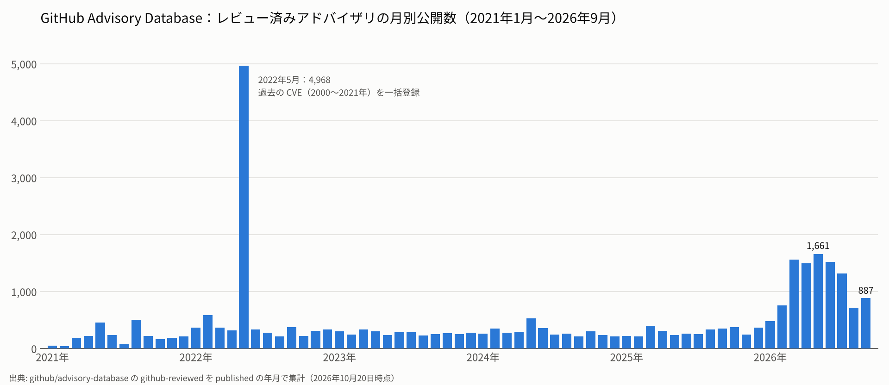

# 5. GHSA における昨今の脆弱性状況の現状

> 目安時間: 15分

## この章のねらい

- NVD の演習で見えた **CPE の曖昧さ**を整理し、なぜ影響判定が難しくなるのかを説明できるようになる
- **GitHub Advisory Database（GHSA）**が、パッケージの名前とバージョンで脆弱性を表すことで、この曖昧さをどう解消しているのかを理解する
- GHSA の最近の状況と、GHSA でも扱えない範囲を知る

---

## 5.1 演習の振り返り：CPE の曖昧さ

第4章の演習で、次のようなことに気づいたのではないでしょうか。

### 名前が一致しない

PC にインストールされているソフトウェアの名前と、NVD の CPE の名前、CNA が書いた名前は、それぞれ違っていました。

| ソフトウェア一覧での名前 | NVD の CPE（vendor:product） | CNA が書いた名前（vendor / product） |
|---|---|---|
| Zoom Workplace for Windows | `zoom:workplace_desktop`（target_sw: `windows`） | Zoom Communications / Zoom Workplace for Windows |
| Adobe Acrobat Reader（Continuous） | `adobe:acrobat_reader_dc`（update: `continuous`） | Adobe / Acrobat Reader DC |
| 7-Zip（Igor Pavlov） | `7-zip:7-zip` | mcmilk / 7-Zip |

CPE の名前は NVD が管理する辞書（CPE Dictionary）で決められていて、**インストールされているソフトウェアの名前から機械的に導くことはできません**。スキャナはさまざまな工夫で名前を対応づけていますが、対応づけを間違えると、脆弱性の見逃し（偽陰性）や誤検知（偽陽性）につながります。

### バージョンの書き方がそろっていない

- **CPE にバージョン範囲がない**：Microsoft 365 Apps の脆弱性（たとえば CVE-2026-70242）の CPE はバージョンが `-`（該当なし）になっていて、どのビルドが影響を受けるのかが CPE からは分かりません。CNA の情報でも、修正バージョンの欄が `https://aka.ms/OfficeSecurityReleases`（リリースノートの URL）になっていることがあります
- **CNA ごとに書式が違う**：同じ「6.24.0 未満、または 7.0.0 以上 7.24.0 未満」という範囲でも、`< 6.24.0; 7.0.0 < 7.24.0` のような自由な書き方をする CNA があります
- **そもそも CPE がない**：VLC の例のように、NVD のエンリッチメントが行われていない CVE には CPE がありません

### ライブラリをうまく表せない

ソフトウェア開発では、アプリケーションそのものより、**アプリケーションが使っているライブラリ**の脆弱性が問題になることが多くあります。たとえば、Node.js の HTTP クライアントライブラリ **undici** の脆弱性（CVE-2026-1525）は、NVD では次のように表されています。

```
cpe:2.3:a:nodejs:undici:*:*:*:*:*:node.js:*:*   versionEndExcluding: 6.24.0
cpe:2.3:a:nodejs:undici:*:*:*:*:*:node.js:*:*   versionStartIncluding: 7.0.0, versionEndExcluding: 7.24.0
```

一方、開発者の手元にある `package-lock.json` には、次のように書かれています。

```json
"node_modules/undici": {
  "version": "7.23.0"
}
```

`package-lock.json` には「npm の `undici` というパッケージ」とは書かれていても、「`nodejs` というベンダーの `undici`」とは書かれていません。また、Node.js 本体にも undici が組み込まれていますが、**Node.js のどのバージョンが影響を受けるのか**は、この CPE からは読み取れません。

> **ポイント**：CPE は「製品」を識別するための仕組みで、パッケージマネージャーが扱う「**パッケージ**」を識別するためには作られていません。そのため、ライブラリの脆弱性を CPE で正確に表すのは難しいのです。

## 5.2 GHSA とは

**GitHub Advisory Database** は、GitHub が運営する、**オープンソースのパッケージ**を中心とした脆弱性データベースです。登録されている各アドバイザリには、**GHSA ID**（GitHub Security Advisory ID）が付きます。

```
GHSA-2mjp-6q6p-2qxm
     └──┴──┴── 4 文字ずつ 3 つに区切られた英数字
```

最大の特徴は、影響を受けるソフトウェアを「**エコシステム（パッケージマネージャー）＋パッケージ名**」で表すことです。パッケージ名は、npm や PyPI などの**レジストリに登録されている名前そのまま**です。そのため、`package-lock.json` や `requirements.txt` などのロックファイルと、機械的に照らし合わせることができます。

### 3 種類のアドバイザリ

| 種類 | 内容 |
|---|---|
| **GitHub レビュー済み（GitHub-reviewed）** | GitHub のキュレーター（専門スタッフ）が内容を確認し、**エコシステム・パッケージ名・影響を受けるバージョン範囲**を対応づけたもの |
| **未レビュー（Unreviewed）** | NVD に公開された CVE を自動で取り込んだもの。**パッケージとの対応づけはされていない**（`affected` が空） |
| **マルウェア（Malware）** | npm などで見つかった悪意のあるパッケージの情報。GitHub の Web サイトや API で提供される |

影響判定に使えるのは、主に **GitHub レビュー済み**のアドバイザリです。

### アドバイザリが作られるまで

GHSA の情報は、主に次の 3 つの経路から集まります。

1. **リポジトリのセキュリティアドバイザリ**：オープンソースのメンテナーが、自分のリポジトリで脆弱性情報を作成・公開する。研究者はリポジトリの**プライベート脆弱性報告（Private Vulnerability Reporting, PVR）**を使って、非公開でメンテナーに報告できる。メンテナーは GitHub に **CVE ID の採番を依頼**できる（GitHub 自身が CNA であるため）
2. **NVD などの外部の情報源**：NVD に公開された CVE を未レビューのアドバイザリとして取り込み、キュレーターがパッケージと対応づける
3. **各言語の公式アドバイザリなど**: npm Security advisories、FriendsOfPHP、Go Vulncheck、Python Packaging Advisory Database、Ruby Advisory Database、RustSec、コミュニティのプルリクエストなど。

どちらの経路でも、キュレーターが確認したものが **GitHub レビュー済み**のアドバイザリとして公開されます。

### どこで使われているか

- **Dependabot**：GitHub のリポジトリの依存関係を調べ、脆弱なパッケージがあれば通知（アラート）し、更新のプルリクエストを作る
- **npm audit**：npm の脆弱性チェックコマンドも、GitHub Advisory Database を使っている
- **オープンデータ**：データベース全体が [github/advisory-database](https://github.com/github/advisory-database) リポジトリで公開されていて、誰でも自由に利用できる

## 5.3 GHSA の読み方

GHSA のデータは、**OSV（Open Source Vulnerability）形式**の JSON で公開されています。OSV は、Google などが中心となって作った、オープンソースの脆弱性情報のための共通形式です。先ほどの undici の脆弱性（CVE-2026-1525）は、GHSA では次のように表されています（一部を省略）。

```json
{
  "id": "GHSA-2mjp-6q6p-2qxm",
  "aliases": ["CVE-2026-1525"],
  "summary": "Undici has an HTTP Request/Response Smuggling issue",
  "severity": [
    { "type": "CVSS_V3", "score": "CVSS:3.1/AV:N/AC:L/PR:N/UI:N/S:U/C:N/I:L/A:L" }
  ],
  "affected": [
    {
      "package": { "ecosystem": "npm", "name": "undici" },
      "ranges": [
        { "type": "ECOSYSTEM", "events": [ { "introduced": "0" }, { "fixed": "6.24.0" } ] }
      ]
    },
    {
      "package": { "ecosystem": "npm", "name": "undici" },
      "ranges": [
        { "type": "ECOSYSTEM", "events": [ { "introduced": "7.0.0" }, { "fixed": "7.24.0" } ] }
      ]
    }
  ],
  "database_specific": {
    "cwe_ids": ["CWE-444"],
    "severity": "MODERATE",
    "github_reviewed": true
  }
}
```

| 項目 | 内容 |
|---|---|
| `id` | GHSA ID |
| `aliases` | 同じ脆弱性の別の ID。CVE ID があればここに入る |
| `affected[].package` | **エコシステム**（`npm`、`PyPI`、`Maven`、`Go` など）と**パッケージ名** |
| `affected[].ranges[].events` | `introduced`（このバージョンから影響を受ける）と `fixed`（このバージョンで修正された）の組で、影響を受ける範囲を表す。`introduced: "0"` は「最初のバージョンから」の意味 |
| `severity` | CVSS ベクトル |
| `database_specific.github_reviewed` | GitHub がレビュー済みかどうか |

### NVD と GHSA の比較

同じ CVE-2026-1525 を、NVD と GHSA で比べてみましょう。

| | NVD | GHSA |
|---|---|---|
| 影響を受けるソフトウェアの表し方 | `cpe:2.3:a:nodejs:undici:...:node.js:...` | `npm` の `undici` |
| ロックファイルとの照合 | ベンダー名などを推測して対応づける必要がある | パッケージ名でそのまま照合できる |
| バージョン範囲 | `versionStartIncluding` / `versionEndExcluding` など | `introduced` / `fixed` |
| バージョンの比べ方 | 明確な決まりがない | **エコシステムの規則**（npm ならセマンティックバージョニング）に従う |
| CVSS | 9.8（NVD）と 6.5（CNA）の 2 つ | 6.5（Moderate） |

GHSA では「`npm` の `undici` の 7.23.0」が影響を受けるかを、ロックファイルの情報だけで判定できます。このように、パッケージを「エコシステム・名前・バージョン」で一意に表す考え方は、**Package URL（PURL）**という形式でも使われています。

```
pkg:npm/undici@7.23.0
pkg:pypi/requests@2.32.3
pkg:maven/org.apache.logging.log4j/log4j-core@2.14.1
```

PURL は、ソフトウェアの部品表（SBOM）や OSV でも使われている、パッケージの共通の識別子です。

> **補足**：CVSS も NVD と GHSA で違っています。NVD は 9.8（Critical）、GHSA は CNA（OpenJS Foundation）と同じ 6.5（Moderate）を採用しています。第2章で学んだように、**誰が付けたスコアか**を確認しましょう。

## 5.4 GHSA の昨今の状況

### アドバイザリ数の推移

下図は、GitHub レビュー済みのアドバイザリが毎月いくつ公開されたかを数えたものです。



| 年 | レビュー済み | 未レビュー |
|---|---:|---:|
| 2021 | 2,548 | 1,975 |
| 2022 | 8,656 | 175,311 |
| 2023 | 3,270 | 25,231 |
| 2024 | 3,545 | 35,936 |
| 2025 | 3,569 | 44,775 |
| 2026（10月20日まで） | **11,048** | 71,201 |

- 2022年の急増は、過去の CVE（2000〜2021年）をまとめて登録したことによるものです。未レビューのアドバイザリも、この年に NVD の過去分をまとめて取り込んでいます
- 2023〜2025年はレビュー済みが毎月 200〜400 件程度で安定していましたが、**2026年3〜6 月は 1,500 件前後、その後も 2025 年の 2〜4 倍の水準**に急増しました。2026年は 10 月の時点で、すでに 2025年の約 **3 倍** です
- 2026年に公開されたレビュー済みアドバイザリのうち **1,259 件は CVE ID を持っていません**。GHSA にしかない脆弱性情報もあるということです

※ GitHub が公表している数値とは、withdrawn を除外しているなど数え方の違いによりずれます。本資料の数値は [`scripts/ghsa_monthly.py`](../scripts/ghsa_monthly.py) で再現できます。

### 2026年の急増と、レビューが追いつかない問題

GitHub は 2026年6月のブログで、次のような状況を報告しています。

- 2026年5月のレビュー済みアドバイザリは過去最多の1560件で、2 年前の毎月約 270 件の **5 倍以上**
- プライベート脆弱性報告（PVR）は、1 月の週約 550 件から、5 月には**週 3,000 件以上**に増えた
- リポジトリのセキュリティアドバイザリは、週約 650 件から**週 5,000 件以上**に増えた
- GitHub への CVE 採番依頼は、5 月だけで約 4,000 件と、前年の**約 10 倍**
- 4 月中旬以降、公開までの目標時間を守れておらず、レビューに**数週間**かかるものも出ている
- 既存の Dependabot アラートには影響しないが、**新しいアドバイザリのアラートは遅れる可能性がある**

第1章で見たように、GitHub は 2026年に最も多くの CVE を採番した CNA（1〜10月で 12,443 件）でもあります。NVD と同じように、GHSA もまた**脆弱性情報の急増にどう対応するか**という課題に直面しています。GitHub は、レビューの手順を変えずに体制とツールを強化しつつ、パッケージの利用状況や実際の悪用状況にもとづいて**優先順位をつけてレビューする**方法を検討しているとしています。

### エコシステムごとの内訳

2026年に公開されたレビュー済みアドバイザリを、エコシステムごとに数えると次のようになります（1 つのアドバイザリが複数のエコシステムにまたがることがあります）。

| エコシステム | 主な言語 | 件数 |
|---|---|---:|
| npm | JavaScript / TypeScript | 3,195 |
| PyPI | Python | 2,257 |
| Go | Go | 2,118 |
| Packagist | PHP | 1,411 |
| Maven | Java | 991 |
| crates.io | Rust | 474 |
| NuGet | .NET | 397 |
| RubyGems | Ruby | 188 |

## 5.5 GHSA で扱えないもの

GHSA は、パッケージの脆弱性を正確に表すことができる一方で、扱える範囲には限りがあります。

| 対象 | GHSA で扱えるか | 理由 |
|---|---|---|
| npm・PyPI などのライブラリ | ○ | GHSA の主な対象 |
| Chrome・Zoom など、Windows にインストールするアプリケーション | × | パッケージマネージャーで配布されていない |
| Ubuntu・Red Hat などの **OS のパッケージ**（apt・dnf） | × | 対応するエコシステムがない |

特に重要なのが、**Linux ディストリビューションのパッケージ**です。たとえば、Ubuntu に入っている OpenSSL は、Ubuntu が独自に修正を取り込んだ（バックポートした）バージョンになっていることが多く、「OpenSSL の 3.0.x 未満が影響を受ける」という情報だけでは、正しく判定できません。

> **ポイント**：脆弱性情報は「**誰が配布しているソフトウェアか**」によって、見るべき情報源が変わります。ライブラリならエコシステム（GHSA）、OS のパッケージならディストリビューション自身が出している情報を見る必要があります。これが第7章で扱う **OVAL** と **CSAF** です。

---

## この章のまとめ

- NVD の **CPE** は製品の名前やバージョンの書き方がそろっておらず、特にライブラリの脆弱性を正確に表すのが難しい
- **GHSA** は、影響を受けるソフトウェアを「**エコシステム＋パッケージ名＋バージョン範囲**」で表すため、ロックファイルと機械的に照らし合わせることができる
- GHSA のデータは **OSV 形式**で公開されていて、Dependabot や npm audit で使われている
- 2026年は GHSA でもアドバイザリが**約 3 倍**に急増し、レビューが追いつかない状況が生まれている
- GHSA は OS のパッケージやデスクトップアプリケーションを扱えないため、対象に応じて**情報源を使い分ける**必要がある

次の章では、GHSA の情報を使った影響判定の演習を行います。

## 参考文献

- GitHub, [github/advisory-database](https://github.com/github/advisory-database)（本章の集計データの出典。2026年10月20日時点）
- GitHub Docs, [About the GitHub Advisory database](https://docs.github.com/en/code-security/security-advisories/working-with-global-security-advisories-from-the-github-advisory-database/about-the-github-advisory-database)
- GitHub Blog, [Inside the Advisory Database and what happens when vulnerability volume breaks records](https://github.blog/security/supply-chain-security/inside-the-advisory-database-and-what-happens-when-vulnerability-volume-breaks-records/)（2026年6月29日）
- GitHub Blog, [A year of open source vulnerability trends: CVEs, advisories, and malware](https://github.blog/security/supply-chain-security/a-year-of-open-source-vulnerability-trends-cves-advisories-and-malware/)（2026年3月26日）
- Help Net Security, [Vulnerability reports are arriving faster than GitHub can review them](https://www.helpnetsecurity.com/2026/06/30/github-advisory-database-review/)（2026年6月30日）
- OpenSSF, [OSV Schema](https://ossf.github.io/osv-schema/)
- [Package URL (PURL) specification](https://github.com/package-url/purl-spec)
- NVD, [CVE-2026-1525](https://nvd.nist.gov/vuln/detail/CVE-2026-1525) ／ GitHub, [GHSA-2mjp-6q6p-2qxm](https://github.com/advisories/GHSA-2mjp-6q6p-2qxm)
